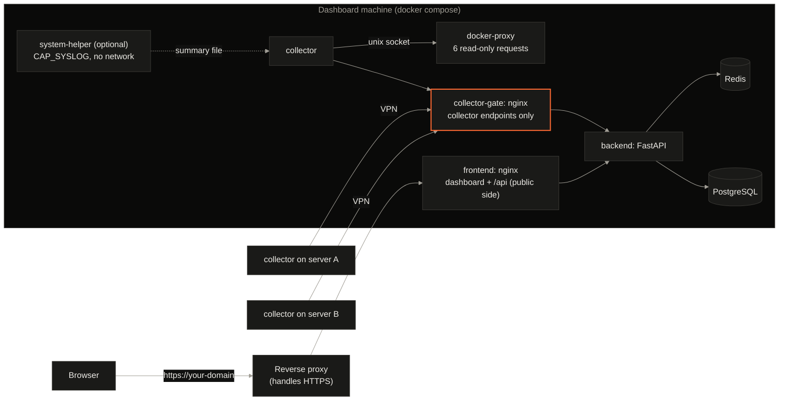

# Infradeck | Know What's Healthy - Fix What Isn't

A self-hosted dashboard for monitoring all your homelab machines in one place.
One machine runs the dashboard; every other machine runs a small collector that
reports host and Docker container metrics back to it, and runs the uptime checks
you define (HTTP, TCP, TLS, DNS, ping and more). It works the same whether the
machines share a LAN or are spread across sites and VPSes.

It also includes an optional incident agent (OpenAI API, set `OPENAI_API_KEY`): it diagnoses each
incident from the data Infradeck already has, proposes fixes, watches whether the fix holds and adds its
diagnosis to your notifications. It reads; it never runs commands on your servers.


Security comes first: the collectors never get the Docker socket, remote machines
report over a VPN to a listener the public internet can't reach, and nothing
the dashboard serves is ever executed on your hosts. See [SECURITY.md](SECURITY.md)
for what every component can touch and the limits of each protection.


## Features

- **One dashboard for every machine**: CPU, RAM, load, swap, network totals and
  uptime per server, plus disk and inode usage for **every mounted filesystem**
  (root, data disks, NFS/SMB shares, ZFS pools).
- **This machine at a glance**: live CPU, memory and disk charts for the machine
  running the dashboard, with the last 30 minutes of history.
- **Statistics for any range**: a page with charts from the last hour to everything ever
  recorded, per server (resources, distributions, busy hours, storage with a
  "full in about N days" estimate, reliability), per container (cards and details) and for the
  whole fleet (incidents over time, containers by state, availability, rankings). Long
  ranges stay cheap because history is summarised into hourly, daily, weekly and monthly rows.
- **Container details**: containers sit in a collapsible list per server, sorted by
  name, with problems (unhealthy, restarting, stopped) shown even when it's closed.
  Open a container to see CPU, memory used/limit, processes, network and disk I/O,
  uptime, ports, health status and CPU/memory history. Stopped containers show how
  they ended (exit code, or "out of memory"), and a **Recent changes** list shows
  containers that appeared, disappeared or came up on a different image.
- **System health per server**: reboots, OOM-killer activity, kernel fault flags,
  clock synchronisation and pending reboots, plus (with the optional system helper)
  whether the last shutdown was clean and which process the OOM killer stopped.
- **Network at a glance**: which ports each server listens on (and which are reachable
  from other machines), whether its firewall configuration changed, and, if you turn
  it on, whether it can still reach the internet.
- **Incidents with sensible alert rules**: disk (with per-mount overrides), inodes,
  memory, swap, load per CPU core, container restart loops, failing healthchecks,
  reboots and crashes, OOM kills, kernel faults, unsynchronised clocks, an
  unreachable or slow Docker daemon, containers that crash or are killed for running
  out of memory, containers that vanish or change image, possible memory leaks, new
  ports opened to the network, firewall changes, lost internet or DNS, and servers
  that stop reporting. One incident per problem, opened only after a sustained
  breach where that makes sense and resolved automatically when it clears.
  Thresholds are editable by admins.
- **Availability checks (like Uptime Kuma, but from your own machines)**: track the
  services you run — **HTTP(s)** status, a **keyword** on a page, a **value in a JSON
  reply**, a **TCP port**, a **TLS certificate's** expiry, a **DNS** record, or an
  **ICMP ping**. Each check runs from the servers you pick (so "down when all fail" or
  "down when any fails" tells a broken service apart from a broken network path), on its
  own interval with retries, and opens an ordinary incident when it fails. The collector
  runs the checks itself — no shell, nothing more than it already has — and a **Test**
  button tries a check from its servers before you save it. One page shows every check
  grouped by tag, with a heartbeat strip, 24 h / 30 d / 1 y uptime, response time and the
  machine each check ran from.
- **Add servers with one command and one click**: click **Connect a server**, run
  the generated command on the new machine, then click **Add**. The command carries
  a single-use token, so only an admin can add machines.
- **Built to be exposed carefully**: a public dashboard behind Traefik, with
  collectors reporting over your VPN instead. Collectors run with no Docker
  socket and no capabilities; a separate read-only proxy answers Docker queries.
- **Per-server check interval** (15 s to 15 min), set from the dashboard.
- **Works on phones**: bottom navigation, touch-sized controls and layouts that
  fit from 320 px wide screens up.
- **Accounts with roles**: the first account (created with a setup token) is the
  admin; other accounts get a read-only view. Passwords must be at least 16
  characters. Redis-backed sessions and login/registration rate limiting.
- **Account security**: optional two-factor sign-in (authenticator app and single-use
  recovery codes), **required for admins by default**; change your password, review
  and end your sessions, and reset a locked-out account from the host.
- **Incident agent** (optional): diagnoses every warning and critical incident from masked evidence, with each
  claim tied to the data; reuses a diagnosis when the same problem returns within a day; resolves the incident once
  its fix holds; adds the diagnosis to notifications; chat about any incident. Monthly budget, per-model prices and
  who-sees-what in Admin. See [Incident agent](docs/assistant.md).


## Architecture



1. Find the one-time **setup token** in the backend log:
   `docker compose logs backend | grep "setup token"`. Open http://localhost:5173
   and register an account with it. Use a password of at least 16 characters (a
   few random words work well). The first account is the admin.
2. This machine appears under **New servers detected**. Click **Add**.
3. Metrics start arriving within a few seconds, and the charts at the top of the
   dashboard start following this machine.

Health check: http://localhost:5173/api/health

```bash
docker compose logs -f backend frontend collector   # follow logs
docker compose --profile system-events up -d        # also run the optional system helper
docker compose down                                 # stop (data volumes are kept)
```

To try **Connect a server** on the same machine, set `COLLECTOR_IMAGE` and
`DOCKER_PROXY_IMAGE` in `.env` to `infradeck-collector:latest` and
`infradeck-docker-proxy:latest` (the images Compose just built). Other machines
need published images; see [Publishing the collector images](docs/deployment.md#publishing-the-collector-images).

## Deploying on a server

The server stack (`docker-compose.server.yml`) publishes the dashboard through the reverse proxy you already run
(a ready-made file for **Traefik** is in [`deploy/`](deploy)) and serves the collector endpoints only on a separate listener bound to your **VPN address**. In short:

1. `cp example.env .env`, then set `POSTGRES_PASSWORD`, `REDIS_PASSWORD`, `DASHBOARD_DOMAIN`, `TRUSTED_PROXIES` and
   `COMPOSE_FILE=docker-compose.server.yml`, with Traefik `docker-compose.server.yml:deploy/traefik.yml` and your
   Traefik names (`COMPOSE_FILE` matters: without it Compose uses the development stack).
2. Generate `SECRETS_KEY` (needed for two-factor sign-in) and set `COLLECTOR_BIND` / `COLLECTOR_PUBLIC_URL` for your VPN.
3. `docker compose up -d --build`, then register the first account with the setup token from the backend log.
4. Click **Connect a server** to add other machines.

Every step, with the reasons and the pitfalls, is in [Deploying on a server](docs/deployment.md) (with Traefik:
[Deploy Infradeck behind Traefik](docs/deploy-traefik.md)) and
[Adding servers](docs/adding-servers.md). To update later: `git pull` and `docker compose up -d --build`.

## Documentation

Full documentation is in the [`docs/`](docs/README.md) folder:

| | |
|---|---|
| [Metrics: what every number means](docs/metrics.md) | How CPU %, load, memory, swap, disk, inodes, network and container figures are measured, and their limits. |
| [Statistics](docs/statistics.md) | History from the last hour to all time, per server, per container and for the whole fleet. |
| [The dashboard and system health](docs/dashboard.md) | Fleet cards, storage, the Network and System rows, the optional system helper. |
| [Alerts and incidents](docs/alerts.md) | Every rule and its default thresholds. |
| [Accounts and two-factor sign-in](docs/accounts.md) | Roles, passwords, authenticator codes, recovery and reset. |
| [The containers](docs/containers.md) | What each container (backend, PostgreSQL, Redis, collector, Docker proxy, helpers) does and why it is there. |
| [Deploying](docs/deployment.md), [Adding servers](docs/adding-servers.md), [Configuration](docs/configuration.md), [Troubleshooting](docs/troubleshooting.md) | Installing, running and fixing it. |
| [Development](docs/development.md), [Database schema](docs/database.md), [API overview](docs/api.md), [Incident agent](docs/assistant.md) | For contributors. |

## Security

[SECURITY.md](SECURITY.md) has the full picture: what each component can touch, and the limits of each
protection. In short:

- **Collectors are unprivileged.** No Docker socket, no capabilities, a read-only filesystem. Only a separate
  read-only proxy (no network, four allowed requests, stripped answers) touches the socket.
- **Collector endpoints are not public.** On the server stack they exist only on the gate bound to your VPN
  address, and joining needs a single-use token plus an admin's click. Remote machines install signed,
  digest-pinned images; the dashboard never serves code that runs on your hosts.
- **Fresh installs can't be claimed** (the first account needs a setup token), passwords need 16 characters,
  and two-factor sign-in is **required for admins by default**.
- **Browser protections:** cross-site requests are refused, with a strict Content-Security-Policy and HSTS.
- **Secrets at rest:** tokens stored only as hashes, passwords with bcrypt, two-factor secrets encrypted with your `SECRETS_KEY`.

## Development and tests

Backend (Python 3.12) and frontend (Node 20) can run without Docker; see [Development](docs/development.md).

```bash
source venv/bin/activate && pip install -r requirements-dev.txt && pytest     # backend, about two minutes
cd src/frontend && node --test                                                # chart and logic helpers, nothing to install
```

[TESTS.md](TESTS.md) explains how the tests work, what they don't cover and what each one is for.

## License

Copyright (c) 2026 Karlo Kajba Šimanić. Licensed under the GNU Affero General Public License v3.0; see [LICENSE](LICENSE).
