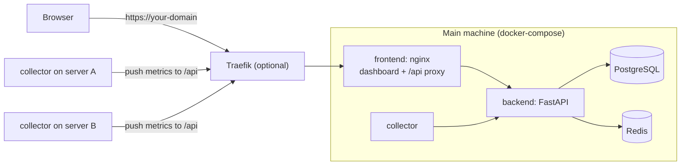

# homelab-agent

A self-hosted dashboard for monitoring all your homelab machines in one place.
One machine runs the dashboard; every other machine runs a small collector that
reports host and Docker container metrics back to it. It works the same whether
the machines share a LAN or are spread across sites and VPSes.

It also includes **Homie**, an optional monitoring-only AI assistant (Gemini)
that can run a fixed set of read-only health checks and never executes commands.

## Features

- **One dashboard for every machine**: CPU, RAM, disk, load, swap, inodes,
  network totals and uptime per server, plus fleet-wide averages and trend charts.
- **Container details**: click any container to see CPU, memory used/limit,
  processes, network in/out, disk I/O, uptime, ports, health status and
  CPU/memory history.
- **Add servers with one command and one click**: run the command from the
  dashboard on a new machine, then click **Add**. No keys, `.env` edits or restarts.
- **Incidents**: alerts for restarting/unhealthy containers and for servers that
  stop reporting (resolved automatically when they come back).
- **Per-server check interval** (15 s to 15 min), set from the dashboard.
- **Accounts** with Redis-backed sessions and login/registration rate limiting.
- **Homie chat assistant** (optional) restricted to predefined read-only checks.

## Architecture



- The **frontend** container (nginx) serves the dashboard and proxies `/api` to
  the backend, so the browser and all collectors use a single address:
  `http(s)://<host>/` for the UI and `http(s)://<host>/api` for the API.
- The **backend** (FastAPI) stores metrics in PostgreSQL and sessions and rate
  limits in Redis. Its own port is published on `127.0.0.1:8000` only, for debugging.
- **Collectors** only make outgoing requests. Monitored machines need no open
  ports, only a route to the dashboard address.
- PostgreSQL and Redis have no host ports; they are reachable only inside the
  Compose network.

## Quick start (laptop / development)

Requirements: Docker with Compose v2.

```bash
cp .env.example .env              # then set POSTGRES_PASSWORD to a long random value
docker compose up -d --build
```

1. Open http://localhost:5173 and register an account.
2. This machine appears under **New servers detected**. Click **Add**.
3. Metrics start arriving within a few seconds.

Health check: http://localhost:5173/api/health

```bash
docker compose logs -f backend frontend collector   # follow logs
docker compose down                                 # stop (data volumes are kept)
```

## Deploying on a server (behind Traefik)

There are two Compose files:

| File | Use | Differences |
|---|---|---|
| `docker-compose.yml` | Laptop / development | Dashboard on port 5173 on all interfaces; plain HTTP; optional Caddy (`--profile https`). |
| `docker-compose.server.yml` | Server behind an existing Traefik | Traefik labels and network; HTTPS-only session cookie; only the first account can register; port 5173 bound to `127.0.0.1`; no Caddy. |

### 1. Fill in the placeholders

In `docker-compose.server.yml`, replace every value marked `# CHANGE ME`:

| Setting | Placeholder | Replace with |
|---|---|---|
| `traefik.http.routers.homelab.rule` | ``Host(`dashboard.example.com`)`` | Your domain |
| `traefik.http.routers.homelab.entrypoints` | `websecure` | Your Traefik HTTPS entrypoint name |
| `traefik.http.routers.homelab.tls.certresolver` | `letsencrypt` | Your Traefik certificate resolver name |
| `traefik.docker.network` **and** `networks.traefik.name` | `traefik_default` | The Docker network Traefik is attached to (both must match) |

Find the network with `docker network ls` or
`docker inspect <traefik-container> --format '{{json .NetworkSettings.Networks}}'`.
The entrypoint and resolver names are in Traefik's static configuration
(`entryPoints:` / `certificatesResolvers:`).

### 2. Create `.env` on the server

```bash
cp .env.example .env
```

Set at least `POSTGRES_PASSWORD`. Optionally add
`COMPOSE_FILE=docker-compose.server.yml` so plain `docker compose ...`
commands use the server file without `-f`.

### 3. Start it

```bash
docker compose -f docker-compose.server.yml up -d --build
```

Open `https://<your-domain>` and register your account right away: on the
server file only the first account can be created, then registration closes.
Traefik terminates HTTPS with its own
certificates; the stack needs no certificate configuration. Collectors on any
machine use `https://<your-domain>/api`.

### Without Traefik

- **Caddy (automatic Let's Encrypt):** with `docker-compose.yml`, set
  `DOMAIN`, `SESSION_COOKIE_SECURE=true` and `FRONTEND_BIND=127.0.0.1` in
  `.env`, open ports 80/443, and run `docker compose --profile https up -d --build`.
- **Private, over a VPN:** install Tailscale or WireGuard on the server and your
  devices, run `docker compose up -d --build`, and use `http://<vpn-ip>:5173`
  (collectors: `http://<vpn-ip>:5173/api`). Nothing is exposed publicly.

## Adding servers

1. On the dashboard, click **Connect a server**. Check the address field: it is
   prefilled with the address you opened the dashboard at and must be reachable
   from the new machine (not `localhost`).
2. Copy the command and run it on the new machine. It needs only Docker.
3. Within a few seconds the machine appears under **New servers detected**
   with a pairing code (also printed in `docker logs homelab-collector`).
   Click **Add**. It starts reporting on its next check, without a restart.

The machine running the dashboard is detected automatically by the stack's own
collector.

### What the command does

```bash
docker run -d --name homelab-collector --restart unless-stopped \
  -e HOMELAB_API_URL=https://dashboard.example.com/api \
  -v /proc:/host/proc:ro -v /:/hostfs:ro \
  -v /var/run/docker.sock:/var/run/docker.sock:ro \
  -v homelab-collector:/var/lib/homelab-collector \
  python:3.12-alpine sh -c 'wget -qO /tmp/collector.py "$HOMELAB_API_URL/collector.py" && exec python -u /tmp/collector.py'
```

| Part | Purpose |
|---|---|
| `--restart unless-stopped` | Survives crashes and reboots. |
| `HOMELAB_API_URL` | Where the dashboard is. The only setting. |
| `/proc:/host/proc:ro` | Host CPU, memory, load, network and uptime. |
| `/:/hostfs:ro` | Disk usage, hostname, OS name and `/etc/machine-id`. |
| `docker.sock` | Container list, status and resource usage. |
| `homelab-collector` volume | Keeps the token after approval, so restarts don't need approval again. |
| `python:3.12-alpine` + `wget` | Official Python image. The collector (one standard-library Python file) is downloaded from the dashboard at every start, so restarting a collector updates it. |

To remove a collector completely:

```bash
docker rm -f homelab-collector && docker volume rm homelab-collector
```

### How registration works

- A collector without credentials asks to join and checks every 5 seconds
  whether it has been approved. Clicking **Add** creates the server; the
  collector then receives its token and saves it.
- Servers are matched on `/etc/machine-id`, so approving a reinstalled machine
  reconnects it to its existing dashboard entry and history.
- If you delete a server, its collector asks to join again. It only comes back
  if you click **Add**. **Dismiss** moves it to a collapsed "Dismissed" list.
- Requests from collectors that stopped asking disappear after 2 minutes and are
  deleted after a day.

Alternatives:

- **Enrollment key (no approval step):** for scripted installs, generate a key
  under **Connect a server → Advanced** and add `-e HOMELAB_ENROLL_KEY=<key>`
  to the command. Only a hash of the key is stored; rotating or revoking it does
  not affect servers that are already connected.
- **Compose instead of `docker run`:** copy the repository to the machine, set
  `HOMELAB_API_URL` in a `.env` next to `collector-compose.yml`, and run
  `docker compose -f collector-compose.yml up -d --build`.

### Networking checklist

- Every monitored machine must reach the dashboard address; the dashboard never
  connects to them.
- For machines outside your LAN, use a public HTTPS domain or a VPN (Tailscale,
  WireGuard). Don't expose plain HTTP to the internet: collector tokens and the
  collector code itself travel over this connection.
- On a LAN, give the dashboard machine a fixed IP (e.g. a DHCP reservation).

## Configuration

### Stack (`.env` next to the Compose file)

| Variable | Default | Description |
|---|---|---|
| `POSTGRES_PASSWORD` | *(required)* | PostgreSQL password. |
| `GEMINI_API_KEY` | empty | Enables the Homie chat assistant. |
| `AGENT_MODEL` | `models/gemini-3.5-flash` | Gemini model for the assistant. |
| `ADMIN_ALERT_WEBHOOK_URL` | empty | Receives JSON alerts for critical `daily_checkup` findings. |
| `SESSION_COOKIE_SECURE` | `false` (dev), `true` (server file) | Send the login cookie over HTTPS only. |
| `SESSION_TTL_SECONDS` | `86400` | Session lifetime. |
| `ALLOW_REGISTRATION` | `true` (dev), `false` (server file) | Let anyone create an account. When `false`, only the first account can be created. |
| `FRONTEND_BIND` | `0.0.0.0` (dev), `127.0.0.1` (server file) | Interface for the dashboard's plain-HTTP port. |
| `FRONTEND_PORT` | `5173` | Dashboard port on the host. |
| `CORS_ORIGINS` | `http://localhost:5173` | Comma-separated origins, only needed if the UI is served from another origin than `/api`. |
| `LOGIN_RATE_LIMIT` / `LOGIN_RATE_WINDOW_SECONDS` | `5` / `60` | Login attempts per IP and per email. |
| `REGISTER_RATE_LIMIT` / `REGISTER_RATE_WINDOW_SECONDS` | `3` / `3600` | Registrations per IP. |
| `HOMELAB_ENROLL_KEY` | empty | Lets the stack's own collector skip approval. |
| `HOMELAB_SERVER_NAME` | host's hostname | Name shown for the stack's own machine. |
| `DOMAIN` | `localhost` | Domain for the optional Caddy profile. |
| `COMPOSE_FILE` | – | e.g. `docker-compose.server.yml` to make it the default on a server. |

### Collector (environment of the collector container)

| Variable | Default | Description |
|---|---|---|
| `HOMELAB_API_URL` | `http://localhost:8000` | Dashboard API address, e.g. `https://dashboard.example.com/api`. |
| `HOMELAB_ENROLL_KEY` | empty | Join immediately instead of waiting for approval. |
| `HOMELAB_SERVER_NAME` | host's `/etc/hostname` | Name shown on the dashboard. |
| `HOMELAB_STATE_DIR` | `/var/lib/homelab-collector` | Where the token is saved (mount a volume here). |
| `HOMELAB_MACHINE_ID` | host's `/etc/machine-id` | Identity used to recognise reinstalled machines. |
| `HOMELAB_SERVER_ID` / `HOMELAB_COLLECTOR_TOKEN` | empty | Explicit credentials (legacy; overrides everything else). |
| `HOST_PROC` / `HOST_ROOT` | `/host/proc` and `/hostfs` if mounted, else `/proc` and `/` | Where the host's `/proc` and filesystem are. |
| `DOCKER_SOCKET_PATH` | `/var/run/docker.sock` | Docker API socket; without it only host metrics are sent. |

The check interval is set per server on the dashboard; collectors pick it up
from the backend's response to each report.

## Security

- **Collector privileges.** The Docker socket mount is effectively root access
  to the host, even with `:ro` (which only protects the socket file itself), and
  `/` is mounted read-only in full. The collector only reads, but whoever
  controls its code controls the machine. Serve the dashboard over HTTPS or a
  VPN, and consider a restricted Docker API proxy such as
  `tecnativa/docker-socket-proxy` that allows only container list/inspect/stats.
- **Pending servers.** Anyone who can reach the dashboard address can make a
  machine appear under **New servers detected** (rate limited per IP), but it
  only reports after someone clicks **Add**. Compare the pairing code with the
  collector's log if unsure.
- **Accounts.** Every logged-in account can see and add pending servers and use
  the assistant (your Gemini key). With `ALLOW_REGISTRATION=false` (the default
  in `docker-compose.server.yml`) only the first account can be created; keep it
  that way on a public domain.
- **Secrets at rest.** Collector tokens and enrollment keys are stored only as
  SHA-256 hashes; passwords are hashed with bcrypt.
- **Client IPs.** nginx accepts `X-Forwarded-For` only from private/Docker
  network addresses (e.g. Traefik), so rate limits see the real client IP and it
  can't be spoofed from outside.

### Homie assistant (monitoring-only)

The assistant has no code path for running shell commands. It may request
exactly one fixed, read-only check at a time: `server_health`,
`container_health`, or `daily_checkup`, implemented with Python system APIs and
Docker's Unix API socket, never the shell or Docker CLI.

The backend container does **not** mount `/var/run/docker.sock`. If you want
the assistant's container checks, point `DOCKER_SOCKET_PATH` at a hardened
Docker API proxy that permits only the required GET endpoints.

`daily_checkup` combines host and container checks. On a critical finding it
POSTs an alert only to `ADMIN_ALERT_WEBHOOK_URL`; without it, the result says
`not_configured` and no request is made. Schedule it from a trusted scheduler
(e.g. a systemd timer) rather than letting the agent create schedules.

## Development

### Backend without Docker

Python 3.12. The backend needs Redis for sessions and rate limits; SQLite works
in place of PostgreSQL.

```bash
python -m venv venv && source venv/bin/activate
pip install -r requirements.txt
docker run -d --name homelab-dev-redis -p 6379:6379 redis:7-alpine   # if Redis isn't running
DATABASE_URL=sqlite:///./dev.db REDIS_URL=redis://localhost:6379/0 \
  uvicorn src.backend.main:app --reload --host 0.0.0.0 --port 8000
```

### Frontend dev server

Node 20 (`.nvmrc`). The Vite dev server proxies `/api` to `localhost:8000`,
matching the production nginx setup.

```bash
nvm install && nvm use
cd src/frontend
npm install
npm run dev -- --host 0.0.0.0
```

Vite prints the URL (5173, or the next free port if the Compose stack already
uses it). `./start_frontend.sh` does the same in one step.

Environment variables for the frontend build:

- `VITE_API_BASE_URL` (default `/api`): API base path or URL.
- `VITE_LIVE_GRAPH_REFRESH_INTERVAL_SECONDS` (default `3`, minimum `1`): how
  often the dashboard refreshes.

After changing frontend or collector code, rebuild the containers:
`docker compose up -d --build`. Otherwise the browser keeps getting the old bundle.

### Tests

```bash
source venv/bin/activate
python -m pytest
```

### Database schema

Tables are created on backend startup (`Base.metadata.create_all`), and new
columns are added with `ALTER TABLE ... IF NOT EXISTS` in the startup hook in
`src/backend/main.py`. `docker/postgres/init/01_create_users.sql` initialises
the `users` table on a fresh volume.

## Project layout

```text
docker-compose.yml          development stack
docker-compose.server.yml   server stack behind Traefik
collector-compose.yml       collector-only stack for monitored machines
docker/
  backend.Dockerfile        FastAPI backend (uvicorn)
  frontend.Dockerfile       Vite build served by nginx
  collector.Dockerfile      standalone collector image
  nginx.conf                serves the UI, proxies /api to the backend
  Caddyfile                 optional HTTPS front door (dev compose, --profile https)
  postgres/init/            SQL run on a fresh PostgreSQL volume
src/
  backend/                  API: auth, monitoring, enrollment, rate limits, models
  agent/
    collector.py            metrics collector (standard library only)
    health_checks.py        read-only checks available to the assistant
    service.py, prompts.py  Gemini assistant
  frontend/                 React + Tailwind dashboard (Vite)
tests/                      pytest suite
```

## API overview

All paths are relative to `/api` when going through the frontend/nginx.

| Method & path | Auth | Purpose |
|---|---|---|
| `GET /health` | – | Database and Redis status. |
| `POST /auth/register`, `POST /auth/login`, `POST /auth/logout`, `GET /auth/me` | session cookie | Accounts and sessions. |
| `GET /auth/config` | – | Whether registration is open. |
| `GET /monitoring/overview` | session | Servers, latest metrics, containers, pending servers, active alerts. |
| `GET /monitoring/servers/{id}/containers/{container_id}` | session | One container's latest stats and history (`?limit=`, max 500). |
| `PATCH /monitoring/servers/{id}/interval` | session | Set check interval (15–86400 s). |
| `DELETE /monitoring/servers/{id}` | session | Remove a server and its data. |
| `POST /monitoring/pending-collectors/{id}/approve` / `…/dismiss` | session | Add or dismiss a server asking to join. |
| `GET` / `POST` / `DELETE /monitoring/enrollment-key` | session | Show status / create or rotate / revoke the enrollment key. |
| `GET /collector.py` | – | Collector source, used by the install command. |
| `POST /monitoring/collectors/register` | – (rate limited) | Collector asks to join; returns a poll secret and pairing code. |
| `POST /monitoring/collectors/register/poll` | poll secret | Collector checks approval; returns its token once approved. |
| `POST /monitoring/collectors/enroll` | enrollment key | Join without approval. |
| `POST /monitoring/metrics/ingest` | collector token | Collector reports host and container metrics. |
| `GET /conversations`, `POST /conversations`, `DELETE /conversations/{id}`, `POST /agent/chat` | session | Homie assistant chats. |
| `GET /logs`, `POST /logs`, `GET /dashboard/summary` | session | Audit log and summary counts. |

## Troubleshooting

| Symptom | Check |
|---|---|
| A new machine never shows up under **New servers detected** | `docker logs homelab-collector` on that machine. "Could not reach …" means the address in the command isn't reachable from it (firewall, `localhost`, wrong IP/domain). |
| Collector log says "Backend no longer accepts server …" | The server was deleted on the dashboard; it is asking to join again, so click **Add** or **Dismiss**. |
| `network traefik_default declared as external, but could not be found` | You're using `docker-compose.server.yml` on a machine without that Traefik network. Use `docker-compose.yml` for development, or fix the network name. |
| Dashboard shows old behaviour after a code change | Rebuild with `docker compose up -d --build` and hard-refresh the browser (Ctrl+Shift+R). |
| Logged out after opening the dashboard at a new address | Login cookies belong to the address they were set on; log in again. |
| Login fails behind HTTPS with `SESSION_COOKIE_SECURE=true` | The cookie is only sent over HTTPS; open the `https://` address, not `http://…:5173`. |
| Server marked offline | It missed 3 check-ins in a row. Check the machine, its collector log and its route to the dashboard. The incident resolves on the next report. |

## License

MIT; see [LICENSE](LICENSE).
