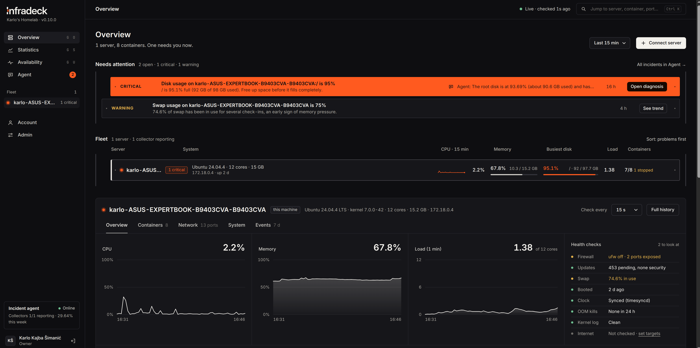
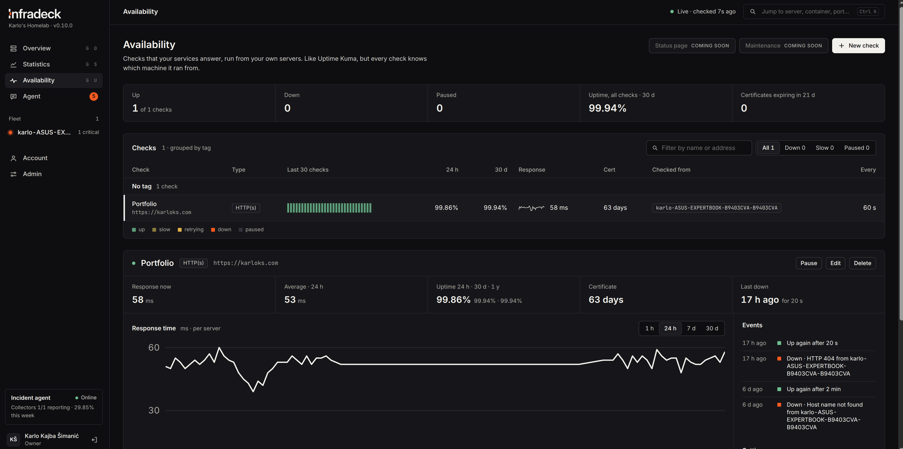
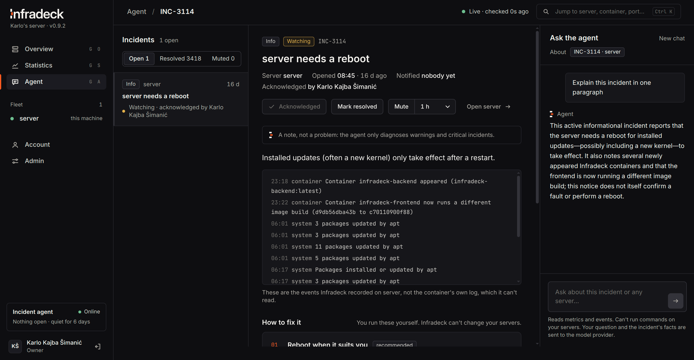

<p align="center">
  
</p>

<p align="center">
  <strong>Know what's healthy. Fix what isn't.</strong><br/>
  Self-hosted monitoring for your homelab: every server, every container and every service you run, in one dashboard.
</p>

<p align="center">
  <a href="LICENSE"></a>
  
  <!-- After the first GitHub release, add:
  <a href="https://github.com/karloks2005/infradeck/releases"></a>
  CI badge (replace ci.yml with the real workflow file name):
  <a href="https://github.com/karloks2005/infradeck/actions"></a>
  -->
</p>

<p align="center">
  <a href="#quick-start">Quick start</a> ·
  <a href="#deploying-on-a-server">Deploy</a> ·
  <a href="#features">Features</a> ·
  <a href="#security">Security</a> ·
  <a href="docs/README.md">Docs</a>
</p>



## Why Infradeck

One machine runs the dashboard. Every other machine runs a small collector that reports host and Docker metrics and runs your uptime checks. It works the same on one LAN or across sites and VPSes.



- **Hosts, containers and uptime in one place.** No separate tools for server metrics, Docker and "is my service up".
- **Checks run from your own machines.** Pick which servers run each check, so you can tell a broken service from a broken network path.
- **Alerts that mean something.** One incident per problem, opened after a sustained breach, closed automatically when it clears.
- **Secure by design.** Collectors never get the Docker socket, report only over your VPN, and install signed, digest-pinned images.
- **An optional AI incident agent that only reads.** It diagnoses warning and critical incidents from masked data and proposes fixes. It never runs commands on your servers.
- **Add a server with one command and one click.**

### What it isn't

- **Not a remote control.** Nothing in Infradeck restarts containers, runs commands or changes your servers; it only reads and reports. The agent's fixes are suggestions you carry out yourself.
- **Not a log collector.** It doesn't gather container or application logs, only metrics, Docker state and system events.
- **Not a high-resolution time-series database.** Each check-in (every 15 s to 15 min) is a snapshot; between check-ins nothing is measured. See [Metrics](docs/metrics.md).
- **Not for every platform.** Collectors run in Docker on Linux hosts.
- **Not a hosted service.** You run it yourself; your data leaves your machines only if you set up notifications or the incident agent.

## Quick start

Try it on one machine with Docker Compose:

```bash
git clone https://github.com/karloks2005/infradeck.git
cd infradeck
cp example.env .env
# Compose refuses to start without these two passwords; this fills them with random values.
sed -i "s/^POSTGRES_PASSWORD=$/POSTGRES_PASSWORD=$(openssl rand -hex 32)/; s/^REDIS_PASSWORD=$/REDIS_PASSWORD=$(openssl rand -hex 24)/" .env
docker compose up -d --build
```

1. Get the one-time **setup token** from the backend log:
   `docker compose logs backend | grep "setup token"`
2. Open http://localhost:5173 and register with it. The first account is the admin. Passwords need at least 16 characters (a few random words work well).
3. This machine appears under **New servers detected**. Click **Add**. Metrics arrive within seconds.

Health check: http://localhost:5173/api/health

```bash
docker compose logs -f backend frontend collector   # follow logs
docker compose --profile system-events up -d        # also run the optional system helper
docker compose down                                 # stop (data volumes are kept)
```

To try **Connect a server** on the same machine, set `COLLECTOR_IMAGE` and `DOCKER_PROXY_IMAGE` in `.env` to `infradeck-collector:latest` and `infradeck-docker-proxy:latest` (the images Compose just built). Other machines need published images; see [Publishing the collector images](docs/deployment.md#publishing-the-collector-images).

## Deploying on a server

The server stack (`docker-compose.server.yml`) publishes the dashboard through the reverse proxy you already run (a ready-made **Traefik** file is in [`deploy/`](deploy)). Collector endpoints are served only on a separate listener bound to your **VPN address**.

1. Clone the repository, check out a release (`git checkout v<version>`), `cp example.env .env`, then set `POSTGRES_PASSWORD`, `REDIS_PASSWORD`, `DASHBOARD_DOMAIN`, `TRUSTED_PROXIES` and `COMPOSE_FILE=docker-compose.server.yml` (with Traefik: `docker-compose.server.yml:deploy/traefik.yml`, plus your Traefik names).
   > `COMPOSE_FILE` matters: without it Compose runs the development stack.
2. Generate `SECRETS_KEY` (needed for two-factor sign-in) and set `COLLECTOR_BIND` / `COLLECTOR_PUBLIC_URL` for your VPN.
3. `docker compose pull && docker compose up -d` (the published, signed images of that release), then register the first account with the setup token from the backend log.
4. Click **Connect a server** to add other machines.

Every step, with the reasons and pitfalls: [Deploying on a server](docs/deployment.md), [Deploy behind Traefik](docs/deploy-traefik.md), [Adding servers](docs/adding-servers.md).
To update: `git fetch --tags && git checkout v<new-version> && docker compose pull && docker compose up -d`. To build from source instead, see [Building from source](docs/deployment.md#building-from-source).

## Features

### Monitoring



- **Every machine**: CPU, RAM, load, swap, network totals and uptime per server, plus disk and inode usage for **every mounted filesystem** (root, data disks, NFS/SMB shares, ZFS pools).
- **Containers**: a collapsible list per server, with problems (unhealthy, restarting, stopped) visible even when it's closed. Per container: CPU, memory used/limit, processes, network and disk I/O, ports, health and history. Stopped containers show how they ended (exit code or out of memory). **Recent changes** shows containers that appeared, disappeared or changed image.
- **System health**: reboots, OOM kills, kernel fault flags, clock sync and pending reboots. With the optional system helper, also whether the last shutdown was clean and which process the OOM killer stopped.
- **Network**: listening ports (and which are reachable from other machines), firewall changes and, optionally, internet reachability.
- **Statistics for any range**, from the last hour to all time, per server, per container and for the whole fleet, including a "disk full in about N days" estimate. Long ranges stay fast because history is rolled up into hourly, daily, weekly and monthly rows.


### Availability checks



Like Uptime Kuma, but run from your own machines: **HTTP(s)** status, a **keyword** on a page, a **value in a JSON reply**, a **TCP port**, **TLS certificate** expiry, a **DNS** record or an **ICMP ping**.
- Each check runs from the servers you pick, with "down when all fail" or "down when any fails".
- Own interval and retries; a **Test** button tries it before you save.
- One page for every check, grouped by tag, with a heartbeat strip, 24 h / 30 d / 1 y uptime and response times.
- The collector runs checks itself: no shell, no extra permissions.



### Incidents and alerts
Rules for disk (with per-mount overrides), inodes, memory, swap, load per core, restart loops, failing healthchecks, reboots and crashes, OOM kills, kernel faults, clock drift, an unreachable Docker daemon, vanished or changed containers, possible memory leaks, newly opened ports, firewall changes, lost internet or DNS, and servers that stop reporting. Thresholds are editable by admins. Full list: [Alerts and incidents](docs/alerts.md).

### Incident agent (optional)



Add an Anthropic, OpenAI or Gemini API key in Admin and the agent diagnoses every warning and critical incident from **masked** evidence, ties each claim to the data, proposes a fix, watches whether it holds and adds the diagnosis to your notifications. You can also chat about any incident. Monthly budget, per-model prices and who sees what are set in Admin. **It reads; it never runs commands.** See [Incident agent](docs/assistant.md).



### Accounts and everyday use
- Roles: the first account is the admin; others get a read-only view.
- Two-factor sign-in (authenticator app + recovery codes), **required for admins by default**. Review and end sessions; reset a locked-out account from the host.
- Per-server check interval from 15 s to 15 min.
- Works on phones, from 320 px wide screens up.

## Architecture


What each container does and why it's there: [The containers](docs/containers.md).

## Security

[SECURITY.md](SECURITY.md) has the full picture: what each component can touch and the limits of each protection. In short:

- **Collectors are unprivileged.** No Docker socket, no capabilities, read-only filesystem. Only a separate read-only proxy (no network, a short allowlist of requests, stripped answers) touches the socket.
- **Collector endpoints are not public.** On the server stack they exist only on the gate bound to your VPN address. Joining needs a single-use token plus an admin's click.
- **Nothing the dashboard serves runs on your hosts.** Remote machines install signed, digest-pinned images.
- **Fresh installs can't be claimed**: the first account needs a setup token. Passwords need 16 characters; two-factor is required for admins by default.
- **Browser protections**: cross-site requests are refused; strict Content-Security-Policy and HSTS.
- **Secrets at rest**: tokens stored only as hashes, passwords with bcrypt, two-factor secrets encrypted with your `SECRETS_KEY`.

## Documentation

Everything is in [`docs/`](docs/README.md):

| | |
|---|---|
| [Metrics](docs/metrics.md) | What every number means, how it's measured and its limits. |
| [Statistics](docs/statistics.md) | History per server, per container and for the whole fleet. |
| [Dashboard and system health](docs/dashboard.md) | Fleet cards, storage, the Network and System rows, the system helper. |
| [Alerts and incidents](docs/alerts.md) | Every rule and its default thresholds. |
| [Accounts and two-factor](docs/accounts.md) | Roles, passwords, authenticator codes, recovery and reset. |
| [The containers](docs/containers.md) | What each container does and why it's there. |
| [Deploying](docs/deployment.md) · [Adding servers](docs/adding-servers.md) · [Configuration](docs/configuration.md) · [Troubleshooting](docs/troubleshooting.md) | Installing, running and fixing it. |
| [Development](docs/development.md) · [Database schema](docs/database.md) · [API](docs/api.md) · [Incident agent](docs/assistant.md) | For contributors. |
| [Changelog](CHANGELOG.md) | What changed in each release, and what to do when upgrading. |

## Development and tests

Backend (Python 3.12) and frontend (Node 24) can run without Docker; see [Development](docs/development.md).

```bash
source venv/bin/activate && pip install -r requirements-dev.txt && pytest     # backend, about four minutes
cd src/frontend && node --test                                                # chart and logic helpers, nothing to install
```

[TESTS.md](TESTS.md) explains how the tests work, what they don't cover and what each one is for.

## License

Copyright (c) 2026 Karlo Kajba Šimanić. Licensed under the [GNU Affero General Public License v3.0](LICENSE).
